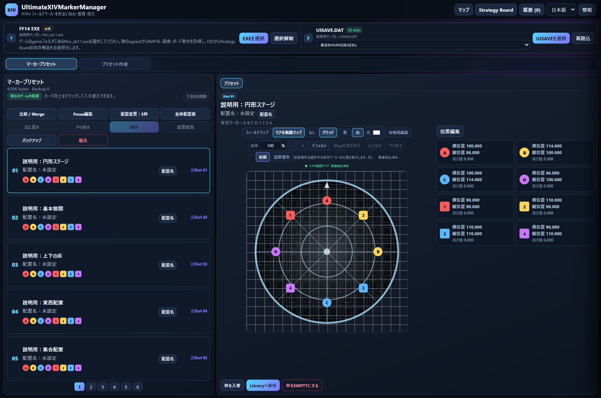

# UltimateXIVMarkerManager (UXMM)

**FFXIVのフィールドマーカーを、床を見ながら整理・編集・保存するWindows用アプリ。**

**0.1.0.4（更新104回）** / Windows x64 / Dalamud不要

[English](README_EN.md) · [英語操作ガイド](docs/USER_GUIDE_EN.md) · [アプリをダウンロード](https://github.com/Lu-ci-el/UltimateXIVMarkerManager/releases/download/v0.1.0.4/UltimateXIVMarkerManager_0.1.0.4.zip) · [リリース内容](https://github.com/Lu-ci-el/UltimateXIVMarkerManager/releases/tag/v0.1.0.4) · [画像付き操作ガイド](docs/USER_GUIDE.md) · [旧版0.0.9.1のPDF説明書](docs/UltimateXIVMarkerManager_Manual_0.0.9.1.pdf)

画面は9.1のUIに架空の配置とパスを表示した説明用サンプルです。床画像と図面の記号も説明用に作成しています。

## 最新版の変更

- 英語版の説明と画像付き操作ガイドを追加し、アプリZIPにもREADME_EN.txtを同梱しました。設定からEnglishへ切り替えできます。
- 最近のUISAVEの履歴削除、EXE／UISAVEの既定場所探索、フィールド1・2…の切替、床表示の修正を含みます。
- 煉獄1層の初期金属床と岩床を分離し、選択ボタンと説明・読込文字の重なりを修正しています。
- 0.1.0.4は、フィールド選択行が増えたときにMAP下端が隠れる不具合を修正しました。空き領域に正方形で収まり、座標・倍率は保持します。版は更新回数の十進各桁（0.0.9.9の次は0.1.0.0）です。

## 使い始める

1. リリースのアプリZIPをダウンロードし、フォルダごと展開します。
2. `UltimateXIVMarkerManager.exe`を起動します。必要な場合は[.NET 10 Desktop Runtime x64](https://dotnet.microsoft.com/en-us/download/dotnet/10.0)と[WebView2 Runtime](https://developer.microsoft.com/en-us/microsoft-edge/webview2/)を導入します。
3. 有効な保存済みEXEを優先し、未設定なら標準のインストール場所を確認します。見つからない場合は「EXEを選択」でゲームの`game`フォルダにある`ffxiv_dx11.exe`を選びます。隣の`sqpack`からMAP名・画像・図面素材を取得し、保存構造を照合するために必須です。
4. 標準のドキュメント場所に一意のUISAVEがあれば自動選択します。複数キャラクターがある場合や見つからない場合は「UISAVEを選択」で対象キャラクターの`UISAVE.DAT`を開きます。場所の探し方は[操作ガイド](docs/USER_GUIDE.md#section-04)にあります。
5. マーカーを編集して「作業中Presetへ反映」。FFXIVを終了して「保存」を押し、保存枠と差分を確認します。

Library・独立マップへの保存と、ゲームのUISAVEへの保存は別の操作です。ゲームへの書き込み前にはバックアップと状態の確認を行います。

## 主な機能

| 機能 | 対応範囲 |
| --- | --- |
| マーカー編集 | ドラッグ・座標入力・枠入替・比較/Merge・Focus編集・選択枠の保存 |
| バックアップ / 復元 | 自動バックアップ、保存履歴からマーカー枠の復元 |
| Library | 配置の保管、フォルダ・タグ・メモ・お気に入り、Pack取込 |
| リアル戦闘MAP | 初期 / 設置場所・保存高さの切替、別高さのグレー表示、表示の移動、10%刻みのホイール倍率 |
| MAPキャッシュ | アプリ直下の`MAP`に永続保存、条件が一致する画像を再利用 |
| ゲームのStrategy Board | 保存/共有リストの閲覧、フォルダ開閉、外部保存・読込、挿入・削除、共有/外部図面を保存リストへ追加 |
| 独立マップ / UXMM独自図面 | マップ単体保存、図面オブジェクトの編集、Map PACK作成・読込 |
| 既存共有コード | 既存オブジェクトの位置・表示等の限定編集。独自図面からのゲーム用コード新規生成は未対応 |

ゲームの保存/共有リスト内の図面配置は**閲覧専用**です。UXMM独自の図面編集とは対応範囲が異なります。

全コンテンツの床選択・欠け・模様の一致は引き続き確認が必要です。ゲームの照明・発光・動くギミックや、リアルタイムのフェーズ判定は再現しません。

今回の署名Build・ZIP検証と、ゲーム実機での動作は別の確認です。マーカー変更→保存→ゲーム反映は0.0.9.1で利用者から成功報告があります。MAPキャッシュ・画像再読込・Strategy外部保存/取込等はバックエンドと画面の背景検証を実施しています。全機能・全コンテンツのゲーム実機確認とは区別しています。

## 説明書と外部ファイル

- [English illustrated guide](docs/USER_GUIDE_EN.md)：英語で起動・編集・保存・MAP・Strategyを説明。
- [画像付き操作ガイド](docs/USER_GUIDE.md)：起動準備、UISAVEの探し方、編集・保存、復元、MAP、Library、Strategyを説明。
- [旧版0.0.9.1のPDF説明書](docs/UltimateXIVMarkerManager_Manual_0.0.9.1.pdf)：ダウンロードして読みやすい版。
- [旧版0.0.9.1の説明書一式ZIP](https://github.com/Lu-ci-el/UltimateXIVMarkerManager/releases/download/v0.0.9.1/UltimateXIVMarkerManager_Manual_0.0.9.1.zip)：HTML・Markdown・PDF・画像をまとめたオフライン版。展開後に`USER_GUIDE.html`を開きます。

| 拡張子 | 用途 |
| --- | --- |
| `.mmp` | Map PACK |
| `.mms` | Strategyの保存リスト・保存フォルダ |
| `.mmsh` | Strategyの共有リスト |

対応する従来の`.uxmm`読込も保持しています。ファイル名を変えるだけでは形式は変換されません。

## 配布について

アプリ本体はリリースに添付しています。このリポジトリに置いているのは説明資料と配布情報です。**アプリの開発ソースは非公開です。** GitHubの「Source code (zip / tar.gz)」に含まれるのは、この配布リポジトリの説明資料です。

アプリZIPは署名済みの配布構成です。EXEだけを取り出さず、同梱ファイルをそのまま展開して使ってください。日本語README.txtと英語README_EN.txtを同梱しています。

不具合を伝える際はアプリ版・コンテンツ名・初期/設置場所/高さ・操作・エラー文を確認してください。画面のEXE / UISAVEパス、キャラクター情報、最近のファイル一覧を隠し、UISAVEや使用中の個人設定フォルダを一般公開しないでください。
