# UltimateXIVMarkerManager 9.1 操作ガイド

> **最新版0.1.0.4の補足**：[英語ガイド](USER_GUIDE_EN.md)と、アプリ同梱README_EN.txtを追加しました。以下の画像・本文は0.0.9.1時点の基本操作ガイドです。旧PDFも0.0.9.1のままです。
>
> 現行版は有効な保存済みEXE／UISAVEを優先し、未設定時は標準のゲーム／ドキュメント場所を確認します。UISAVEが複数、またはファイルが見つからない場合は手動で選択してください。「最近のUISAVE」の「履歴から削除」は一覧だけを削除し、実ファイル・現在の下書き・選択パスを保持します。
>
> 複数の床は「フィールド1、2…」で切り替えます。ゲームのフェーズ自動判定ではありません。煉獄1層の初期金属床はフィールド1、岩床はフィールド2です。説明文・読込状態は選択ボタンと別行に配置しています。背景の変更では保存XYZを変えません。0.1.0.4では操作行の高さに合わせてMAP表示を調整し、下端が隠れないようにしました。

以下の基本操作・画像の対象：配布版 **0.0.9.1**

画面画像は9.1の画面に架空の配置・パス・図面を表示した説明用サンプルです。床の画像と図面の記号も説明用に作成しています。

PDF版：[UltimateXIVMarkerManager_Manual_0.0.9.1.pdf](UltimateXIVMarkerManager_Manual_0.0.9.1.pdf)

## 目次

1. [まずできることを知る](#section-01)
2. [9.1の完成範囲](#section-02)
3. [起動の準備とEXEの選択](#section-03)
4. [編集するUISAVEを開く](#section-04)
5. [マーカーの位置を変える](#section-05)
6. [変更をUISAVEへ保存する](#section-06)
7. [Focus編集と比較 / Merge](#section-07)
8. [Libraryで配置を保管・整理](#section-08)
9. [MAPの表示を調整する](#section-09)
10. [高さが違うマーカーの床を見る](#section-10)
11. [MAPの読込とキャッシュ](#section-11)
12. [バックアップ・復元・更新](#section-12)
13. [ゲームのStrategy Boardを開く](#section-13)
14. [共有・外部図面を保存リストへ](#section-14)
15. [独立マップとUXMM独自の図面](#section-15)
16. [Map PACKを作る・読み込む](#section-16)
17. [ファイルの種類と共有コード](#section-17)
18. [困ったとき・確認してほしいこと](#section-18)

## 01. まずできることを知る

FFXIVのフィールドマーカーを、床を見ながら整理・編集・保存するWindows用の単体アプリです。Dalamudを導入せずに使えます。

マーカープリセット画面。左で枠を選び、右でMAPと配置を確認します。すべて説明用サンプルです。

- マーカーの座標変更、枠の入替、Libraryへの保存、バックアップからの復元ができます。
- リアル戦闘MAPの初期の床と設置場所を切り替え、保存マーカーの高さごとに配置を確認できます。
- ゲームのStrategy Boardは閲覧・外部保存・フォルダ挿入に対応。共有図面を保存リストへ追加できます。
- UXMM独自のマップと図面は編集できます。ゲームの保存図面をそのまま編集する機能とは別です。

> 対象版は9.1（配布版0.0.9.1）です。画像は操作説明用であり、ゲーム画面の再現精度や全コンテンツの動作確認を示すものではありません。

## 02. 9.1の完成範囲

実装済みの機能と、まだ確認・拡張が必要な機能を分けて確認できます。

| 機能 | 9.1でできること / 確認範囲 |
| --- | --- |
| マーカー編集・保存 | ドラッグ・座標入力・枠入替・選択枠の保存。9.1で変更→保存→ゲーム反映に成功した利用者の実機報告があります。 |
| 保存の保護・復元 | ゲーム起動中の書込停止、自動バックアップ、差分確認、保存履歴からのマーカー復元。 |
| Library・比較・Focus編集 | 配置の保管・分類、比較/Merge、選択マーカーの移動・回転・間隔調整など。 |
| MAPの操作 | フィールドMAP / リアル戦闘MAP、初期 / 設置場所、保存マーカーの高さ選択、ドラッグ移動、10%刻みのホイール倍率。 |
| MAPの永続キャッシュ | アプリ直下のMAPへ保存。条件が一致する画像を再利用し、別のMAPや再起動から戻ったときの再生成を減らします。 |
| ゲームのStrategy Board | 保存/共有リストの閲覧、フォルダ開閉、外部保存・読込、フォルダ挿入・削除、共有/外部図面を保存リストへ追加。 |
| 独立マップ・独自図面 | マップ単体保存、ジョブ・ロール・マーカー・図形・AOE等の配置編集、Map PACKの作成・読込。 |
| 既存共有コードの限定編集 | 攻略図編集では既存オブジェクトの位置・表示・ロック・サイズ・角度を変更できます。追加・削除・種類変更は対象外です。 |
| 引き続き確認が必要 | 全コンテンツの床選択、床の欠け、ゲームの模様・質感との一致。ゲームの照明・発光・動くギミック・リアルタイムのフェーズ判定は再現しません。 |
| 未対応の編集 | ゲームの保存/共有リスト内の図面を自由に直接編集する機能。UXMM独自図面からゲーム用共有コードを新規生成する機能。 |

> MAPキャッシュ・画像再読込、Strategyの外部保存/取込などはバックエンドと画面の背景検証を実施しています。利用者のゲーム反映報告はマーカー保存についてのものです。全機能・全コンテンツのゲーム実機確認とは区別しています。

## 03. 起動の準備とEXEの選択

アプリZIPを展開し、ゲームのffxiv_dx11.exeを選択します。EXEの指定は9.1では必須です。

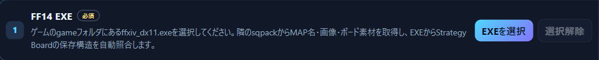

起動準備の入口。EXEを選んでからUISAVEを開きます。説明用サンプル。

1. リリース添付のUltimateXIVMarkerManager_0.0.9.1.zipをダウンロードします。
2. ZIP全体を、書き込みできる場所へ展開します。中のUltimateXIVMarkerManagerフォルダを開きます。
3. UltimateXIVMarkerManager.exeを起動します。EXE・DLL・runtimes・署名ファイルは同じ構成のまま使います。
4. 画面上部の「EXEを選択」で、ゲームのインストール先にあるgameフォルダのffxiv_dx11.exeを選びます。
5. 同じgameフォルダにsqpackがある構成を使用します。「選択解除」で選び直せます。

| 必要なもの | 選び方 |
| --- | --- |
| Windows x64 | この配布版はWindowsの64bit用です。 |
| .NET 10 Desktop Runtime x64 | 未導入ならMicrosoft公式ページの「.NET Desktop Runtime」Windows x64を入れます。コンソール用.NET Runtimeだけでは不足します。 |
| WebView2 Runtime | 未導入ならMicrosoft公式のEvergreen Runtimeを入れます。 |
| FFXIVのローカルゲームデータ | ゲームのEXEと隣のsqpack。素材を取得し、保存構造を照合するために使用します。 |

[.NET 10公式ダウンロード](https://dotnet.microsoft.com/en-us/download/dotnet/10.0)

[WebView2公式ダウンロード](https://developer.microsoft.com/en-us/microsoft-edge/webview2/)

> EXEを選ぶ理由：sqpackからMAP名・画像・ボード素材を取得し、EXEからStrategy Boardの保存構造を照合します。ゲームを起動したり、画面を操作したりするための指定ではありません。

## 04. 編集するUISAVEを開く

UISAVE.DATはキャラクターごとのローカル設定ファイルです。編集対象のキャラクターに対応するファイルを選びます。

1. Windowsの「ドキュメント」を開きます。保存先を変更している場合は、実際のドキュメントの場所を開きます。
2. My Games → FINAL FANTASY XIV - A Realm Reborn → 対象キャラクターのフォルダと進みます。
3. その中のUISAVE.DATを「UISAVEを選択」で開きます。フォルダ名に含まれるキャラクター識別情報は、説明書では表示していません。
4. 読み込まれたコンテンツ名・配置・保存日時を見て、編集したいキャラクターの配置か確認します。
5. 次回以降は「最近のUISAVE」から選び、「前回を開く」を利用できます。ゲーム側で配置を変えたあとは「再読込」で更新します。

| 操作 | ゲームを起動したままでよいか |
| --- | --- |
| 読込・閲覧・PC上で下書き編集 | 可能です。ゲーム側の変更が入ったときは再読込・差分確認を行います。 |
| UISAVEへマーカーを保存・復元 | FFXIVを終了してから実行します。起動中は保護機能で書き込みが停止します。 |
| Strategyの挿入・削除・保存リスト追加 | FFXIVを終了してから実行します。変更内容の確認画面を経由します。 |
| MAP / Strategyを外部ファイルへ保存 | ゲームのUISAVEを書き換えない外部保存です。画面の保存対象を確認してください。 |

> 画面上部には実際の選択パスが表示されます。自分の画面を共有するときは、EXE / UISAVEのパスと最近のファイル一覧を隠してください。UISAVE、バックアップ、個人設定フォルダを配布物へ含めないでください。

## 05. マーカーの位置を変える

MAPの表示操作とマーカーの座標編集は分かれています。座標を変えるときは「位置編集」を開始します。

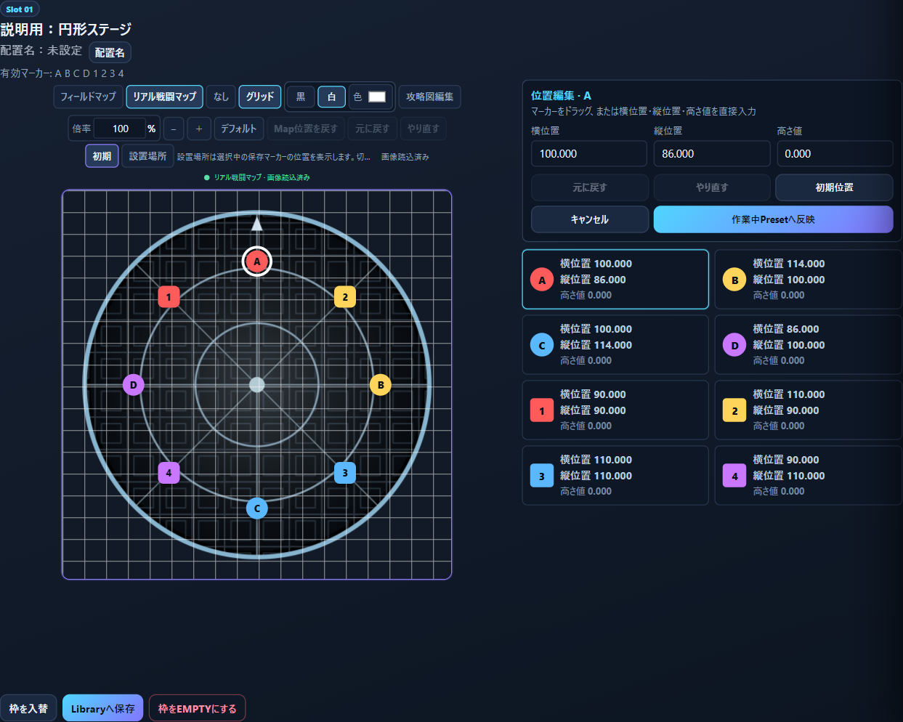

位置編集の画面。右上で横位置・縦位置・高さ値を入力できます。説明用サンプル。

1. 左のマーカープリセットで編集する枠を選びます。
2. 「位置編集」を押し、変更するマーカーを選びます。
3. マーカーをドラッグするか、「横位置」「縦位置」「高さ値」を直接入力します。横位置はX、縦位置はZ、高さはYです。
4. 「元に戻す」「やり直す」「初期位置」で調整します。変更をやめる場合は「キャンセル」です。
5. 「作業中Presetへ反映」で下書きに適用します。確認ダイアログの内容を確認して続行します。
6. ゲームへ反映するには、FFXIV終了後に左側の「保存」を実行します。

> 「作業中Presetへ反映」だけではUISAVEは変更しません。MAPの床・倍率・背景の移動を変えただけでも、マーカーの保存座標は変わりません。

## 06. 変更をUISAVEへ保存する

マーカー編集や枠の入替を終えたら、保存する枠と変更内容を確認して書き込みます。

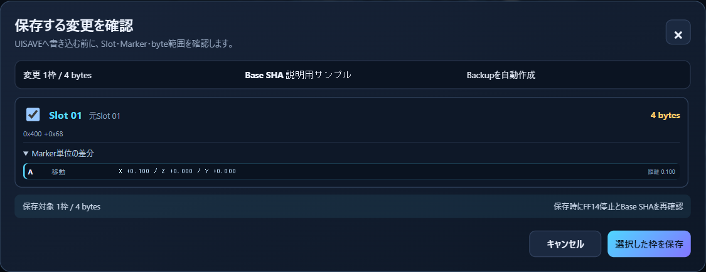

保存前の確認画面。変更枠を選び、マーカー単位の差分を確認します。説明用サンプル。

1. FFXIVを終了します。編集対象のUISAVEが他の操作で変わっていないか確認します。
2. マーカープリセット側の「保存」を押します。未変更の場合は保存できません。
3. 「保存する変更を確認」で対象Slotと差分を確認します。保存しない枠はチェックを外します。
4. 「選択した枠を保存」を押します。保存前に自動バックアップとファイル状態の再確認が行われます。
5. 保存結果を確認してからFFXIVを起動し、対象のマーカープリセットを確認します。

- カード同士のドラッグで枠を入れ替えられます。「配置変更：5枠」は今のページ、「全体配置板」は全枠をまとめて扱います。
- 「元に戻す」「やり直す」は作業中の変更に使います。「変更取消」は下書きをゲーム内の保存配置へ戻します。
- 「枠をEMPTYにする」も下書きへの操作です。保存確認前に対象枠を確かめてください。

> 9.1ではマーカーの位置を変更・保存し、ゲームで反映を確認できた利用者の実機報告があります。保存に失敗した場合は、エラーを確認してから再読込します。成功の表示を確認せずに反映済みと扱わないでください。

## 07. Focus編集と比較 / Merge

複数のマーカーをまとめて調整したいときは、Focus編集の操作パネルを使います。

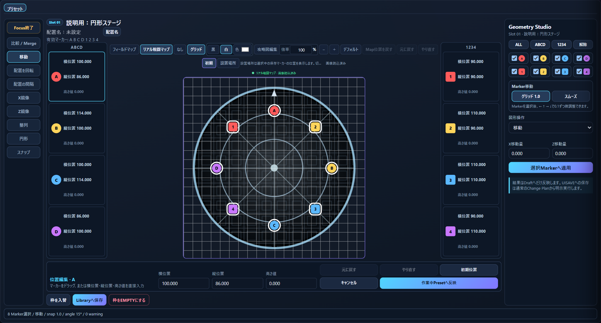

Focus編集。左右の操作パネルで選択・微調整・まとめて変換できます。説明用サンプル。

1. 編集対象の枠を選び、「Focus編集」を押します。
2. ALL / ABCD / 1234、または各マーカーのチェックで対象を選びます。
3. 「移動」「配置を回転」「配置の間隔」などを選び、パラメーターを設定します。左右反転・整列・円形配置・スナップも選べます。
4. 選択マーカーへの適用結果を確認します。「Focus終了」で通常画面へ戻り、通常の保存手順を使います。

- 「グリッド 1.0」はドラッグを1.0刻みにそろえ、「スムーズ」は細かく動かす操作です。
- マーカーを選択後、矢印キーで0.1ずつ微調整できます。
- 「比較 / Merge」では比較元と対象枠を指定して差分を確認します。必要なマーカーを選んで下書きに反映し、最後に保存します。
- Focus編集やMergeの適用結果も下書きです。ゲームへの保存は別途必要です。

## 08. Libraryで配置を保管・整理

LibraryはPC側に配置を保存する場所です。ゲーム内のマーカー枠とは別に整理できます。

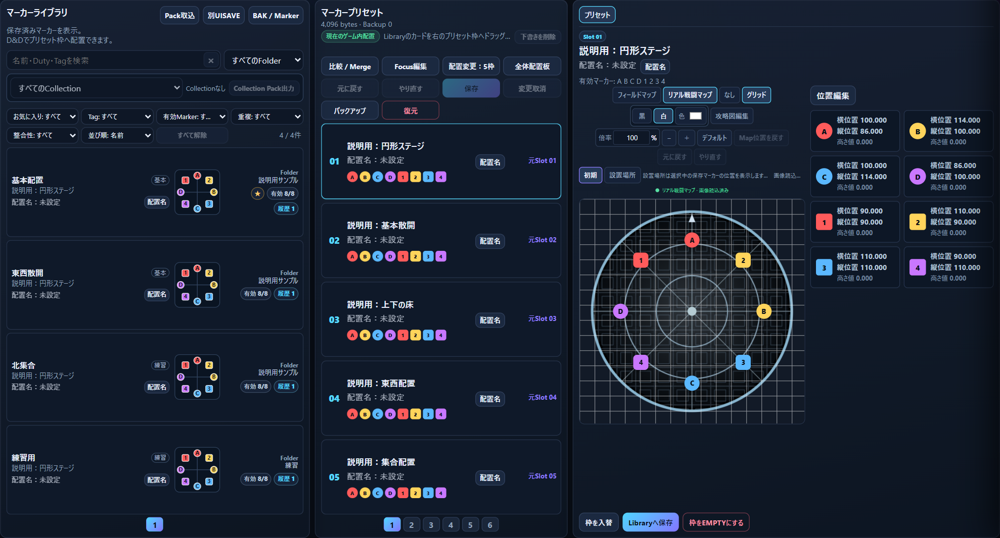

「プリセット作成」画面。Library、配置先の枠、詳細を並べて扱えます。説明用サンプル。

1. 保存したい枠を選び、詳細下部の「Libraryへ保存」を押します。
2. 名前・フォルダ・タグ・メモを入力して保存します。お気に入りや編集履歴も利用できます。
3. 「プリセット作成」でLibraryを開き、検索やフォルダ・タグ等のフィルターで探します。
4. 配置をゲームの枠へドラッグして下書きに入れます。対象枠と座標を確認し、必要なら編集します。
5. ゲームへ反映する場合は通常の「保存」で対象枠を確認します。Libraryの保存だけではゲームの枠は変更されません。

- 別UISAVEやBAK / Marker、Preset Packから配置を取り込めます。取込元と出力先を確認してください。
- Collection Pack出力は配置のまとまりを外部へ保存する操作です。Library全体の個人データをそのまま共有する必要はありません。
- 「配置名」はPC側の整理名です。正式コンテンツ名やゲーム内の共有コードとは別に扱います。

## 09. MAPの表示を調整する

リアル戦闘MAPは、ゲームのローカル素材から床を真上に描いた表示です。位置合わせの参考として使います。

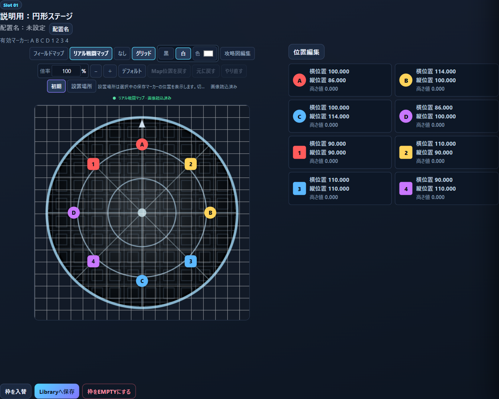

MAPの切替・倍率・グリッドは詳細画面の上側で操作します。説明用サンプル。

| 操作 | 効果 |
| --- | --- |
| フィールドマップ / リアル戦闘マップ / なし | 通常の地図画像、床の俯瞰表示、背景なしを切り替えます。 |
| 初期 / 設置場所 | 初期の床と、選択中の保存マーカーに合わせた場所を切り替えます。 |
| ホイール / 倍率入力 | ホイールは10%刻み。数値入力でも倍率を指定できます。 |
| MAPの背景をドラッグ | 背景とマーカーの表示を一緒に移動します。保存座標は変えません。 |
| Map位置を戻す / デフォルト | 前者は倍率を保って表示位置だけ中央へ。後者は標準表示へ戻します。 |
| グリッド / 黒・白・色 | 配置を合わせやすいグリッド表示と線の色を選びます。 |

> MAPの移動とマーカーの移動を区別してください。マーカーを変えるときは「位置編集」を使います。床の模様・光・色はゲーム内の最終表示と一致しない場合があります。

## 10. 高さが違うマーカーの床を見る

地上・地下など、保存マーカーのY座標が分かれている場合は、表示する高さを選べます。

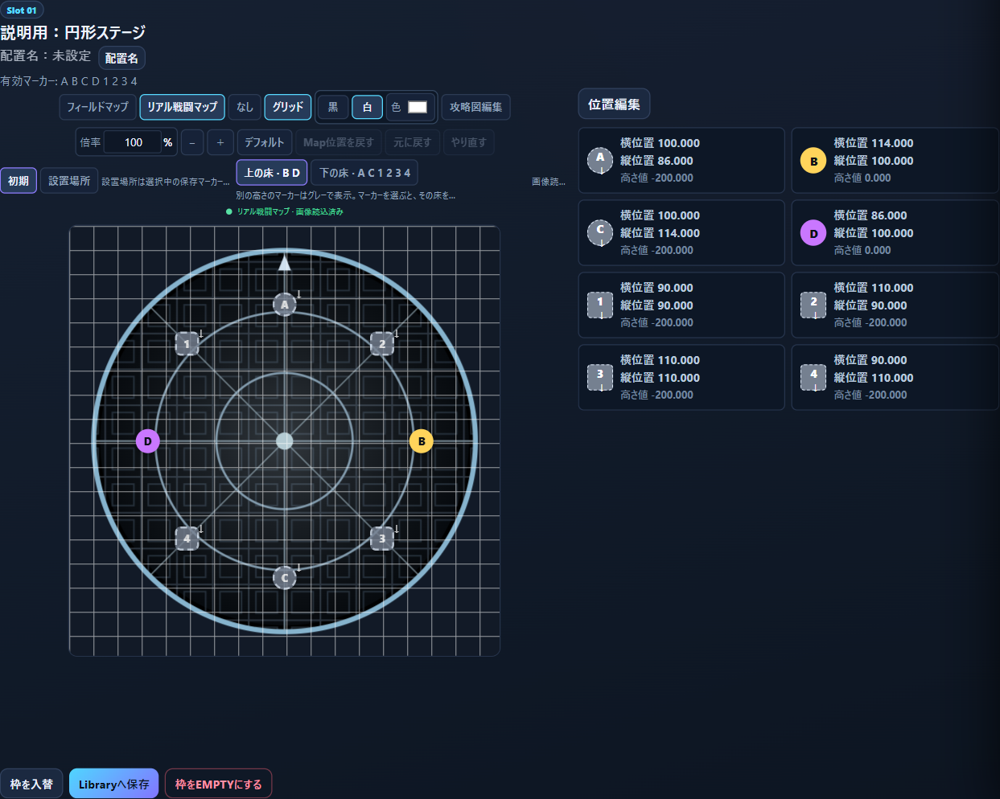

上の床を表示した例。別の高さのマーカーはグレーと矢印で示されます。説明用サンプル。

1. 最初は「初期」の表示から確認します。保存配置に合わせて見るときは「設置場所」を選びます。
2. 複数の高さがあると「上の床」「下の床」などのボタンが表示されます。ラベルに対象マーカーが示されます。
3. 高さのボタン、MAP上のマーカー、または右のマーカー位置カードを選び、その保存高さに合わせた背景へ切り替えます。
4. 表示中の高さと違うマーカーはグレーになり、上なら↑、下なら↓が付きます。同じ高さのマーカーは通常の色です。

> 色がグレーになるのは高さの違いを表す表示であり、マーカーの種類や保存色を変える操作ではありません。単一の高さの配置では高さの切替ボタンは不要です。初期の床や床の抽出が正しくないコンテンツは引き続き確認中です。

## 11. MAPの読込とキャッシュ

一度作成したMAP画像と表示情報は、アプリのフォルダ直下にあるMAPへ保存されます。

- 初回はゲームデータから床を解析・描画するため、表示まで時間がかかる場合があります。処理中は「リアル戦闘MAPをロードしています…」が表示されます。
- 9.1ではMAP画像を永続保存し、別のフィールドや再起動から戻ったときに条件が一致する保存画像を利用します。従来の512MB到達による自動削除は廃止しています。
- コンテンツ、床の高さ、保存マーカーの配置、ゲームデータの版などが変わると、別の画像の作成が必要になる場合があります。すべての切替が即時表示になるわけではありません。
- ゲーム更新後はゲームデータを再確認してください。以前の画像が一致しない場合は再生成されます。
- MAPは使うほど容量が増えます。画像を残したい場合は、更新時にも同じアプリフォルダのMAPを保持します。

| 見え方 | まず確認すること |
| --- | --- |
| ロード中の表示が続く | 初回の処理完了を待ちます。EXEと隣のsqpackが正しいゲームデータか確認します。 |
| 画像読込失敗 / 背景が出ない | 処理が終わってから再読込、またはMAP表示を選び直します。続く場合はエラー内容とコンテンツ名を記録します。 |
| 床が違う / 端が欠ける | 初期・設置場所・高さを確認します。表示の移動や倍率で見切れているだけか、床自体が欠けているか区別します。 |
| 模様や色がゲームと違う | 光・発光・動的な床や一部素材は完全には再現できません。床抽出や質感の差は既知の調整範囲です。 |

> キャッシュは表示を速くするためのデータです。バックアップやLibraryとは用途が違います。不要なMAPを整理する場合も、元のUISAVEやバックアップと取り違えないでください。

## 12. バックアップ・復元・更新

ゲームの設定ファイル、マーカーの履歴、Library、MAPは役割が違います。更新や共有の際には分けて扱います。

1. 明示的に控えを作るときは「バックアップ」を押します。UISAVE全体のバックアップを作成する操作です。
2. マーカーを保存前の状態に戻すときは「復元」を押し、現在のUISAVEに対応する保存履歴を選びます。
3. FFXIVを終了し、復元内容を確認して「この状態に戻す」を実行します。通常の復元はマーカー枠だけを戻します。
4. アプリ更新前はUXMMを閉じ、現在のアプリフォルダ全体を自分の保管場所へコピーしておきます。
5. 新版ZIPの配布ファイルを同じ構成で更新します。既存の個人データとMAPを保持し、起動後にEXE / UISAVEの選択を確認します。

| データ | 用途と扱い |
| --- | --- |
| UISAVE.DAT | ゲームの設定・マーカー等を含む対象ファイル。編集対象を確認します。 |
| バックアップ・保存履歴 | 保存前の状態を保護します。個人データなので配布や不特定の相手との共有は避けます。 |
| Library / 下書き / 個人設定 | アプリ側の配置整理と作業状態。自分のアプリフォルダと一緒に保管します。 |
| MAP | 一度生成した床画像等の再利用用データ。アプリ直下にあります。 |
| 配布ZIPのEXE・DLL・署名 | 配布版の構成を保ちます。独自変更や一部だけの移動では起動できない場合があります。 |

> この復元操作は、UISAVEのその他の設定やStrategy Boardを巻き戻す機能ではありません。配布する場合は、公開用のアプリZIP・Map PACK・Strategyの外部ファイルを選び、使用中フォルダ全体をそのまま公開しないでください。

## 13. ゲームのStrategy Boardを開く

画面上部の「Strategy Board」で、ゲームの保存リストと共有リストを閲覧できます。

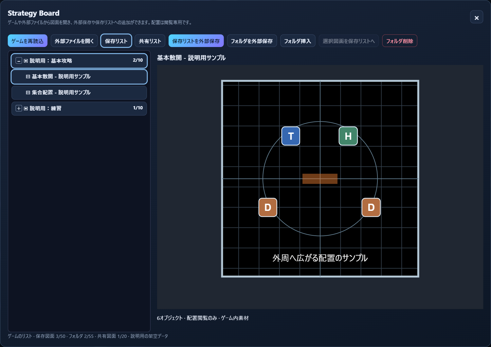

保存リストの例。フォルダ名左の＋ / −で開閉します。図面は説明用サンプルです。

1. EXEと対象UISAVEを開き、上部の「Strategy Board」を押します。
2. 「保存リスト」でフォルダを選び、フォルダ内の図面を選びます。フォルダ名の＋ / −で一覧を閉じたり開いたりできます。
3. 「共有リスト」でゲーム側の共有図面を確認します。
4. ゲームで図面を変更したあとに「ゲームを再読込」で表示を更新します。外部ファイルからゲームのリストへ戻る場合も同じ操作です。

- 9.1の保存 / 共有リストの図面配置は閲覧専用です。この画面でアイコンやAOEを自由に移動・追加する編集はまだできません。
- 「保存リストを外部保存」「共有リストを外部保存」は選択中のリストを外部へ保存します。
- 「フォルダを外部保存」は選択した保存フォルダを取り出します。「フォルダ挿入」「フォルダ削除」は対象UISAVEへ変更を行うため確認画面を経由します。

## 14. 共有・外部図面を保存リストへ

共有図面や別の外部ファイルから図面を取り出し、自分のゲームの保存リストへ追加できます。

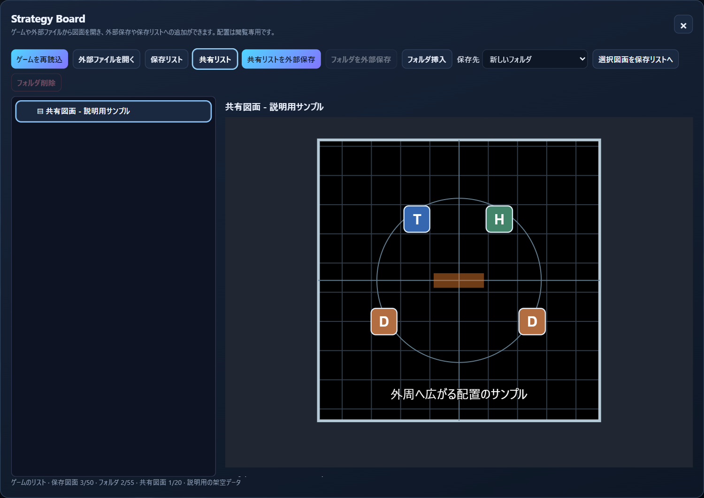

共有リストから保存先を選ぶ画面。図面とデータは説明用サンプルです。

1. ゲームの共有図面なら「共有リスト」を選びます。外部の図面なら「外部ファイルを開く」で.mms / .mmshを読み込みます。
2. 追加したい図面を選択します。外部ファイルの場合は表示されるファイル名と図面を確認します。
3. 「保存先」で新しいフォルダ、または空きのある保存フォルダを選びます。
4. 「選択図面を保存リストへ」を押します。FFXIVを終了し、追加先と図面数を確認して「DATへ保存」を実行します。
5. 追加後はゲームの保存リストから利用します。編集したい場合は、現在はゲーム側の保存リストで編集してください。

> 既存の共有図面を直接上書き編集する機能ではありません。対象UISAVEが未選択、保存構造が未確認、保存先が満杯などの場合は追加できません。外部ファイルを読むだけなら、対象UISAVEを開かず閲覧できる形式もあります。

## 15. 独立マップとUXMM独自の図面

上部の「マップ」では、MAPと配置をアプリ内で独立保存できます。UXMM独自形式の図面は編集できます。

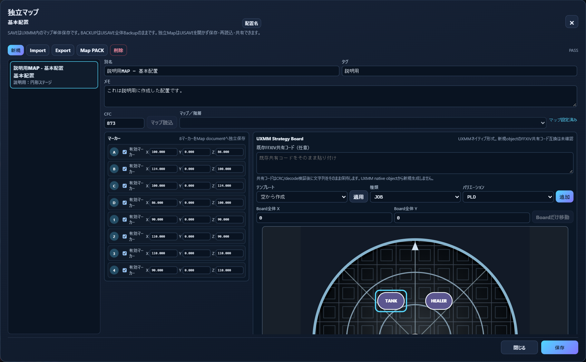

独立マップの編集画面上部。表示領域をスクロールすると図面の全体と編集項目を操作できます。説明用サンプル。

1. 「マップ」→「新規」で対象のマップ / 階層を選び、別名・タグ・メモを設定します。保存済みのマップを選んで再編集することもできます。
2. マーカーの有効状態と座標を設定します。通常のゲーム内Presetとは別に保存されます。
3. テンプレートを適用するか、種類とバリエーションを選んで「追加」します。ジョブ・ロール・マーカー・図形・AOEを配置できます。
4. 図面上のオブジェクトを選び、位置・サイズ・回転・レイヤー・表示・ロック等を調整します。文字の図形も利用できます。
5. 「保存」でUXMM内に保存します。「Export」「Import」で単体ファイルを出力・読込できます。

> この「保存」は独立マップの保存です。ゲームのUISAVEへ図面を書き込む操作ではありません。既存FFXIV共有コードは検証して保持できますが、追加したUXMM独自オブジェクトからゲーム用共有コードを新規生成する機能はありません。

## 16. Map PACKを作る・読み込む

複数の独立マップを.mmpファイルへまとめて、必要な配置を渡したり取り込んだりできます。

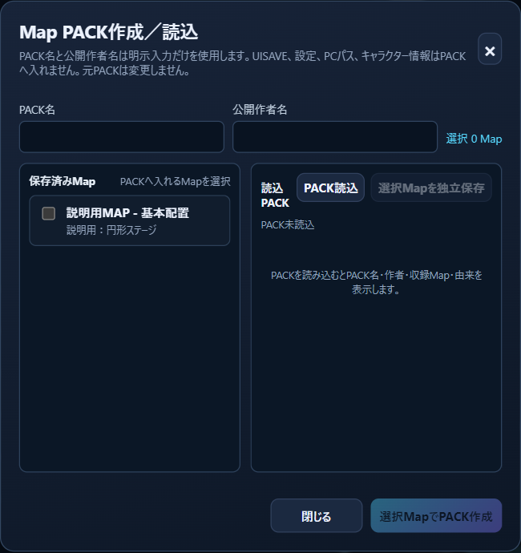

PACK作成 / 読込画面。公開作者名は自分で入力します。説明用サンプル。

1. 独立マップを保存したあと、「Map PACK」を開きます。
2. PACK名と公開作者名を入力し、収録する保存済みMapにチェックを入れます。
3. 「選択MapでPACK作成」で.mmpを保存します。公開作者名は共有してよい名前を入力してください。
4. 受け取ったPACKは「PACK読込」で開きます。名前・作者・収録Map・由来を確認します。
5. 必要なMapを選び、「選択Mapを独立保存」で自分の保存済みMapへ取り込みます。

> Map PACKにUISAVE・個人設定・PCの選択パス・キャラクター情報を自動で入れる構成ではありません。ただし自分で入力したPACK名・作者名・メモや図面の文字は共有内容なので、個人情報を記入しないでください。

## 17. ファイルの種類と共有コード

MAPとStrategyでは用途に合った外部ファイルを使います。ファイル名だけ変えても形式は変換されません。

- マーカーMAPの「攻略図編集」では既存のFFXIV共有コードを読み込めます。コード内の既存オブジェクトの位置・表示・ロック・サイズ・角度を限定的に編集し、共有コードを生成する操作があります。
- この限定編集ではオブジェクトの追加・削除・種類変更は行いません。ゲームの保存/共有リスト内の図面を直接編集する機能とは別です。
- 攻略図のボード座標はゲーム世界のマーカー座標へ自動変換しません。重ねて表示しても、マーカーの設置位置を示す根拠として扱わないでください。
- UXMM独自の図面編集と、既存ゲーム共有コードの限定編集は互換範囲が異なります。独自図面を作っただけでゲーム用共有コードとして利用できるわけではありません。

| 拡張子 / 操作 | 内容と保存先 |
| --- | --- |
| .mmp | Map PACK。複数の独立マップをまとめたファイル。「Map PACK」で扱います。 |
| .mms | Strategyの保存リスト、または保存フォルダの外部ファイル。「Strategy Board」で扱います。 |
| .mmsh | Strategyの共有リストの外部ファイル。「Strategy Board」で扱います。 |
| 従来の.uxmm | 対応する従来形式の読込も保持しています。種類に対応したImport / Pack取込 / 外部ファイルを開くを選びます。 |
| .zip / .pdf | アプリ配布ZIPと操作説明書。使用中の個人設定やUISAVEを入れたZIPとは区別してください。 |

> 外部保存したいときは、対象の画面のExport / 外部保存を使って保存先を選びます。ゲームの共有リストを保存リストへ追加する操作は、前の「共有・外部図面を保存リストへ」を参照してください。

## 18. 困ったとき・確認してほしいこと

まず画面のエラーと、選択している対象・保存状態を確認します。個人データをそのまま公開する必要はありません。

- 不具合を伝える場合は、アプリ版、コンテンツ名、初期 / 設置場所 / 高さ、操作とエラー文を記録すると確認しやすくなります。
- 画面を共有する場合はEXE / UISAVEのパス、最近のファイル一覧、キャラクター情報を隠します。元のDATやバックアップの一般公開は避けてください。
- 全コンテンツの床・素材・保存構造を同じ精度で確認済みではありません。ゲーム更新後の互換性や床表示は引き続き確認が必要です。

| 症状 | 確認すること |
| --- | --- |
| 起動できない / .NETが必要 | .NET 10 Desktop Runtime x64、WebView2、ZIP全体の展開を確認します。EXEだけを抜き出さず配布構成を保ちます。 |
| UISAVEを選べない | 先にffxiv_dx11.exeを選択し、隣のsqpackを含むゲームデータを確認します。 |
| 保存できない | FFXIVを終了します。未変更・処理中・対象ファイルの変更検出などの理由を画面で確認します。 |
| ゲームに反映しない | 対象キャラクターのUISAVEか、作業中Presetへの反映後に通常の「保存」まで完了したか確認します。 |
| MAPの色・形・端がおかしい | 初期 / 設置場所 / 高さ・倍率・表示位置を確認します。床抽出の誤選択や欠けが残るコンテンツは確認が必要です。 |
| マーカーがグレー | 高さが違うマーカーの表示です。矢印と高さ値を確認し、そのマーカーの床へ切り替えます。 |
| Strategyを自由に動かせない | ゲームの保存/共有図面は閲覧専用です。UXMM独自図面は「マップ」側で編集します。 |
| 外部図面を保存リストへ追加できない | 対象UISAVE、保存構造の照合、保存先フォルダの空き、ゲーム終了を確認します。 |

[配布リポジトリ](https://github.com/Lu-ci-el/UltimateXIVMarkerManager)

[リリースとダウンロード](https://github.com/Lu-ci-el/UltimateXIVMarkerManager/releases)

> このリポジトリはアプリの配布情報と説明資料を置く場所です。アプリの開発ソースは非公開です。GitHubが表示するSource code ZIP / tar.gzは、この配布リポジトリの説明資料であり、アプリの開発ソースを含みません。
